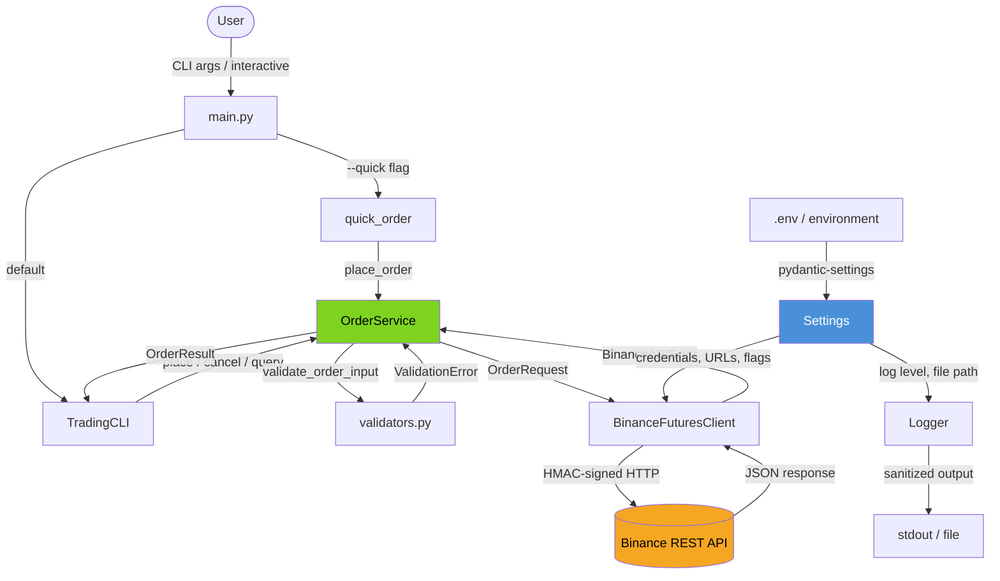
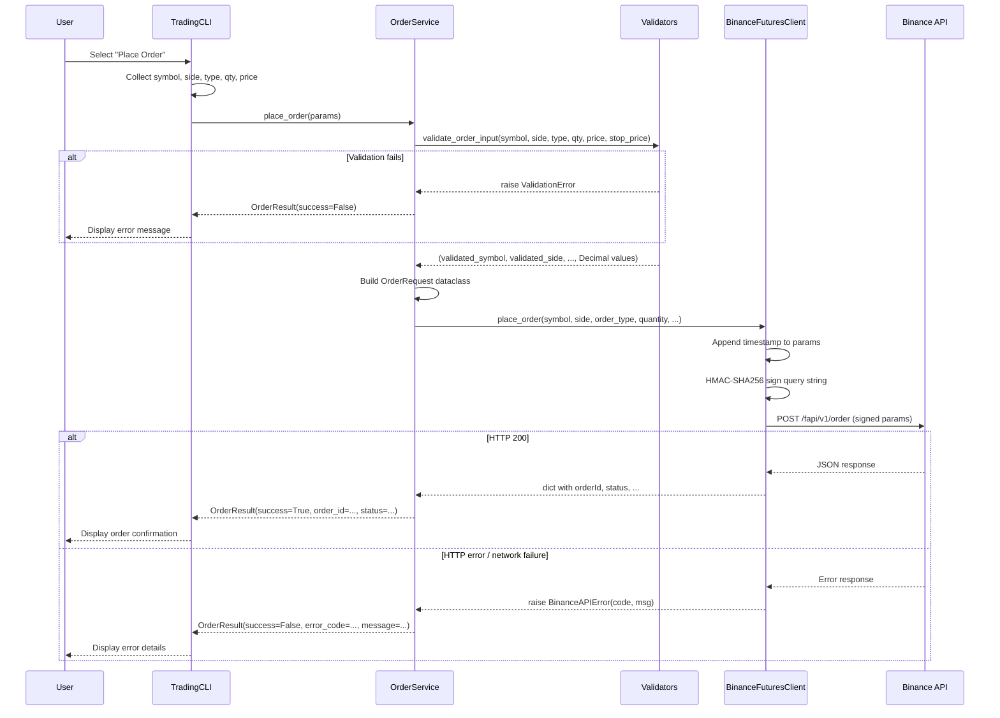
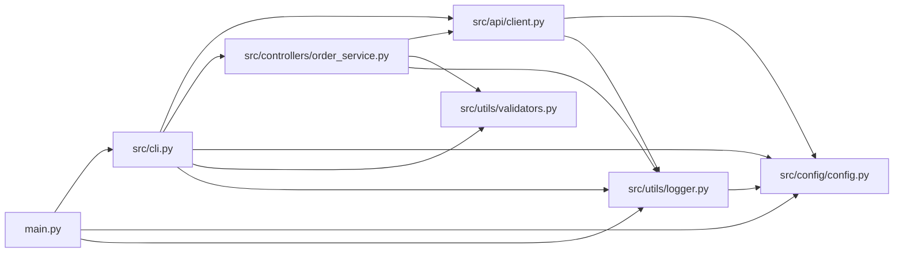
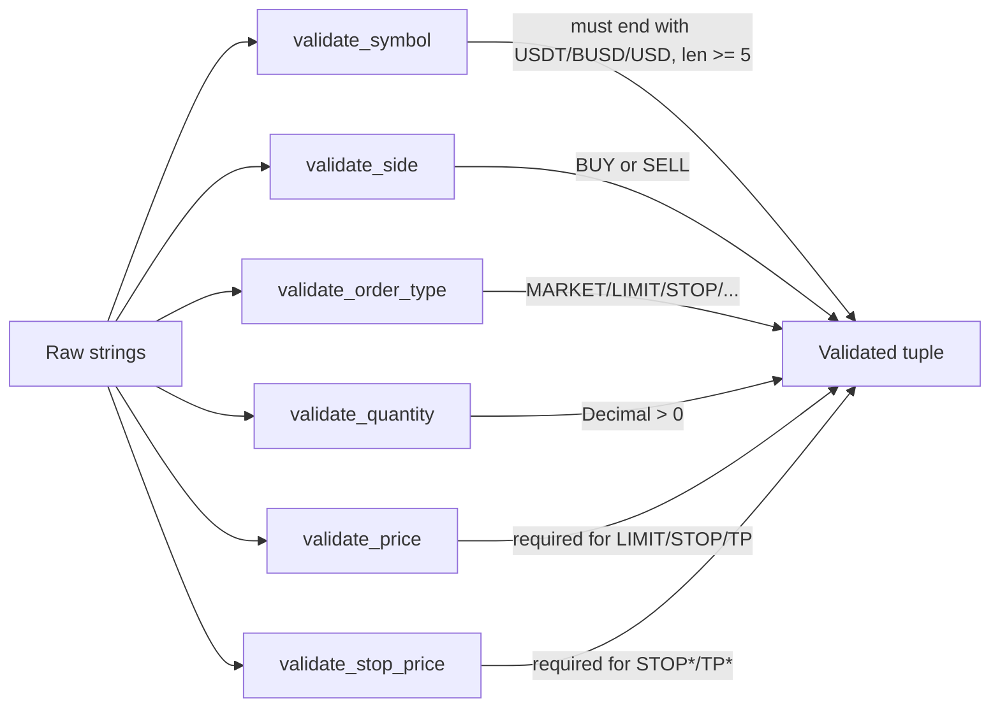
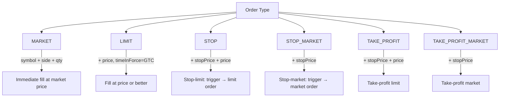
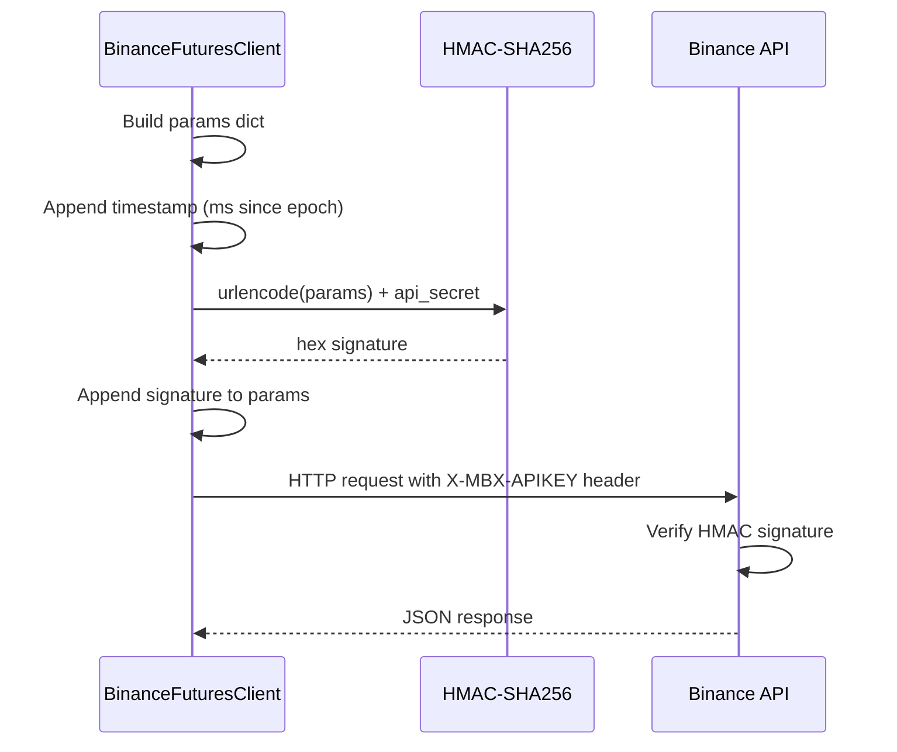
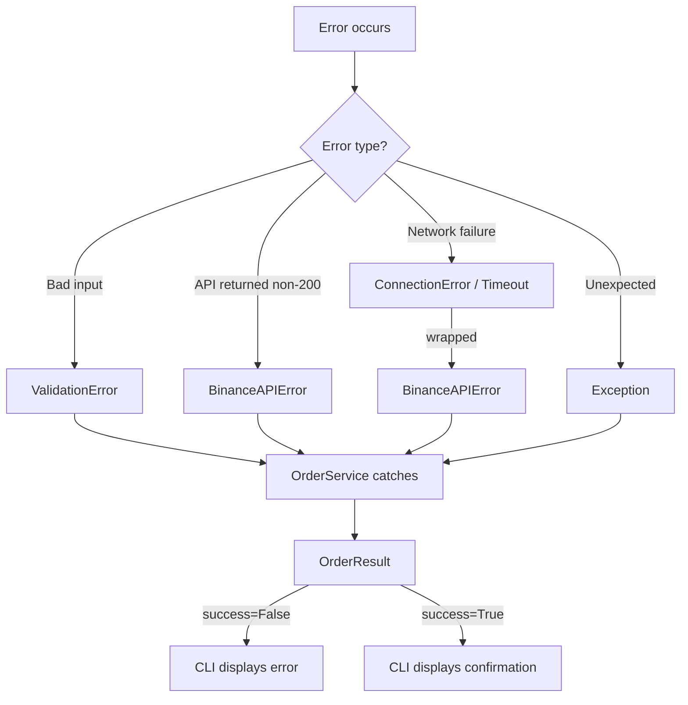

<p align="center">
  
</p>

<h1 align="center">Binance Futures CLI</h1>

A Python command-line client for Binance USDT-M Futures. It validates market, limit, and conditional orders, and uses testnet by default.

<p align="center">
  <a href="#quick-start">Quick start</a> ·
  <a href="#usage">Usage</a> ·
  <a href="#architecture">Architecture</a> ·
  <a href="#disclaimer">Risk</a>
</p>

## Quick start

**Requirements:** Python 3.10 or later and API keys from the [Binance Futures Testnet](https://testnet.binancefuture.com/).

```bash
git clone https://github.com/AbhiramVSA/binance-bot.git
cd binance-bot
python -m venv .venv
source .venv/bin/activate  # Windows: .venv\\Scripts\\activate
python -m pip install -r requirements.txt
cp .env.example .env
```

Add the testnet credentials to `.env`, then start the guided CLI:

```bash
python main.py
```

Quick mode sends a testnet order when you provide the order details:

```bash
python main.py --quick -s BTCUSDT -S BUY -t MARKET -q 0.001
```

The `--mainnet` flag selects the live exchange. It uses real funds. Keep testnet enabled while you learn the command interface.

## Architecture

### System Overview



### Request Lifecycle



### Module Dependency Graph



### Directory Structure

```
binance-bot/
├── main.py                          # Entry point: argparse, mode routing
├── pyproject.toml                   # Project metadata, dependencies, pytest config
├── .env                             # API credentials (git-ignored)
├── src/
│   ├── __init__.py
│   ├── cli.py                       # TradingCLI class, quick_order(), run_cli()
│   ├── api/
│   │   ├── __init__.py
│   │   └── client.py                # BinanceFuturesClient (HMAC signing, HTTP)
│   ├── config/
│   │   ├── __init__.py
│   │   └── config.py                # Pydantic Settings singleton
│   ├── controllers/
│   │   ├── __init__.py
│   │   └── order_service.py         # OrderService, OrderRequest, OrderResult
│   └── utils/
│       ├── __init__.py
│       ├── logger.py                # Logger setup, sanitized API log helpers
│       └── validators.py            # Input validation (symbol, side, type, qty, price)
└── tests/
    ├── __init__.py
    ├── test_validators.py
    ├── test_config.py
    ├── test_client.py
    └── test_order_service.py
```

## Core Components

### `BinanceFuturesClient` — API Layer

HTTP client for Binance USDT-M Futures REST API. Handles authentication and transport.

- **HMAC-SHA256 signing**: Every private request appends `timestamp` and `signature` params. The signature is an HMAC of the URL-encoded query string using the API secret.
- **Endpoint map**: Statically defined in `ENDPOINTS` dict — `order`, `open_orders`, `account`, `position`, `exchange_info`, `ticker_price`, `server_time`.
- **Error handling**: Non-200 responses raise `BinanceAPIError` with the API error code and message. Network errors (timeout, connection refused) are caught and re-raised as `BinanceAPIError`.
- **Session reuse**: Uses `requests.Session` with persistent headers (`X-MBX-APIKEY`, `Content-Type`).

### `OrderService` — Business Logic

Orchestrates validation and execution. All public methods return `OrderResult` and never raise exceptions.

- **Validation pipeline**: Calls `validate_order_input()` which chains individual validators (`validate_symbol`, `validate_side`, `validate_order_type`, `validate_quantity`, `validate_price`, `validate_stop_price`).
- **Convenience methods**: `place_market_order()`, `place_limit_order()`, `place_stop_market_order()`, `place_stop_limit_order()`, `place_take_profit_market_order()` — all delegate to `place_order()`.
- **Result pattern**: Returns `OrderResult` dataclass with `success`, `order_id`, `status`, `message`, `error_code`, and `raw_response`.

### `Settings` — Configuration

Pydantic `BaseSettings` subclass that loads from `.env` or environment variables. Singleton instance exported as `settings`.

| Variable | Type | Default | Description |
|----------|------|---------|-------------|
| `BINANCE_API_KEY` | `str` | `""` | API key |
| `BINANCE_API_SECRET` | `str` | `""` | API secret |
| `USE_TESTNET` | `bool` | `true` | Route to testnet or mainnet |
| `TESTNET_BASE_URL` | `str` | `https://testnet.binancefuture.com` | Testnet endpoint |
| `MAINNET_BASE_URL` | `str` | `https://fapi.binance.com` | Mainnet endpoint |
| `LOG_LEVEL` | `str` | `INFO` | Python logging level |
| `LOG_TO_FILE` | `bool` | `false` | Enable file logging |
| `LOG_FILE_PATH` | `str` | `trading_bot.log` | Log file path |

### Validators

All validators raise `ValidationError` on bad input. Quantities and prices are parsed to `Decimal` for precision.



### Logger

- Formats: `%(asctime)s | %(levelname)-8s | %(name)s | %(message)s`
- **Sensitive data sanitization**: `_sanitize_params()` masks `signature`, `api_key`, `apiKey`, `secret` in log output.
- Helpers: `log_api_request()`, `log_api_response()`, `log_api_error()`, `log_order_submitted()`, `log_order_result()`.

## Order Types



| Type | Required Params | `timeInForce` | `workingType` |
|------|----------------|---------------|---------------|
| `MARKET` | symbol, side, quantity | — | — |
| `LIMIT` | + price | GTC (default) | — |
| `STOP` | + price, stopPrice | GTC (default) | CONTRACT_PRICE |
| `STOP_MARKET` | + stopPrice | — | CONTRACT_PRICE |
| `TAKE_PROFIT` | + price, stopPrice | GTC (default) | CONTRACT_PRICE |
| `TAKE_PROFIT_MARKET` | + stopPrice | — | CONTRACT_PRICE |

## Setup

```bash
git clone https://github.com/AbhiramVSA/binance-bot.git
cd binance-bot
python -m venv .venv && source .venv/bin/activate  # or .venv\Scripts\activate on Windows
pip install -e .
cp .env.example .env  # then add your API credentials
```

### Dependencies

| Package | Version | Purpose |
|---------|---------|---------|
| `pydantic` | >= 2.0.0 | Data validation (OrderRequest/OrderResult could extend) |
| `pydantic-settings` | >= 2.0.0 | `.env` / environment config loading |
| `requests` | >= 2.28.0 | HTTP client for Binance REST API |
| `pytest` | >= 7.0.0 | Test framework (dev) |
| `pytest-cov` | >= 4.0.0 | Coverage reporting (dev) |

### Testnet API Keys

1. Go to [Binance Futures Testnet](https://testnet.binancefuture.com/)
2. Log in with GitHub → API Management → Generate key pair
3. Add to `.env`:
   ```
   BINANCE_API_KEY=your_testnet_key
   BINANCE_API_SECRET=your_testnet_secret
   USE_TESTNET=true
   ```

## Usage

### Interactive Mode

```bash
python main.py
```

Presents a menu loop with options:

| Key | Action |
|-----|--------|
| `1` | Place order (guided flow with confirmation) |
| `2` | View open orders |
| `3` | View active positions |
| `4` | Cancel order by ID |
| `5` | Check server connection |
| `6` | Get current ticker price |
| `0` | Exit |

### Quick Mode

Single-shot order placement for scripting and automation:

```bash
# Market buy 0.001 BTC
python main.py --quick -s BTCUSDT -S BUY -t MARKET -q 0.001

# Limit sell 0.01 ETH at $2500
python main.py --quick -s ETHUSDT -S SELL -t LIMIT -q 0.01 -p 2500

# Stop-market sell triggered at $90k
python main.py --quick -s BTCUSDT -S SELL -t STOP_MARKET -q 0.001 --stop-price 90000

# Mainnet with verbose logging
python main.py --quick -s BTCUSDT -S BUY -t MARKET -q 0.001 --mainnet -v
```

### CLI Flags

| Flag | Short | Type | Description |
|------|-------|------|-------------|
| `--quick` | `-Q` | flag | Non-interactive quick order mode |
| `--symbol` | `-s` | str | Trading pair (e.g. `BTCUSDT`) |
| `--side` | `-S` | str | `BUY` or `SELL` |
| `--type` | `-t` | str | Order type (see table above) |
| `--quantity` | `-q` | str | Order quantity |
| `--price` | `-p` | str | Limit price |
| `--stop-price` | | str | Stop/trigger price |
| `--api-key` | | str | Override env API key |
| `--api-secret` | | str | Override env API secret |
| `--mainnet` | | flag | Use mainnet (real funds) |
| `--verbose` | `-v` | flag | DEBUG-level logging |

### Programmatic Usage

```python
from src.controllers.order_service import OrderService

service = OrderService()

# Market order
result = service.place_market_order("BTCUSDT", "BUY", "0.001")

# Limit order
result = service.place_limit_order("ETHUSDT", "SELL", "0.01", "2500")

# Stop-market order
result = service.place_stop_market_order("BTCUSDT", "SELL", "0.001", "90000")

if result.success:
    print(f"Order {result.order_id}: {result.status}")
else:
    print(f"Error [{result.error_code}]: {result.message}")
```

## Authentication Flow



All private endpoints (`/fapi/v1/order`, `/fapi/v2/account`, `/fapi/v2/positionRisk`, etc.) require this signing flow. Public endpoints (`/fapi/v1/time`, `/fapi/v1/exchangeInfo`, `/fapi/v1/ticker/price`) skip signing.

## Testing

```bash
# Run all tests
pytest

# With coverage report
pytest --cov=src

# Verbose output
pytest -v
```

Tests use mocking (`unittest.mock`) to avoid real API calls. Test coverage includes:
- **`test_validators.py`** — symbol format, side/type enum, quantity/price decimal parsing, edge cases
- **`test_config.py`** — settings loading, defaults, `is_configured()` logic
- **`test_client.py`** — request signing, endpoint routing, error handling
- **`test_order_service.py`** — validation pipeline, result mapping, error propagation

## Error Handling



`OrderService.place_order()` catches all exceptions and returns `OrderResult(success=False, ...)` — callers never need try/except.

## Disclaimer

This software is for educational purposes only. Cryptocurrency trading involves substantial risk. Always test on testnet before using mainnet. Never trade with funds you cannot afford to lose.

## License

MIT — see [LICENSE](LICENSE) for details.
